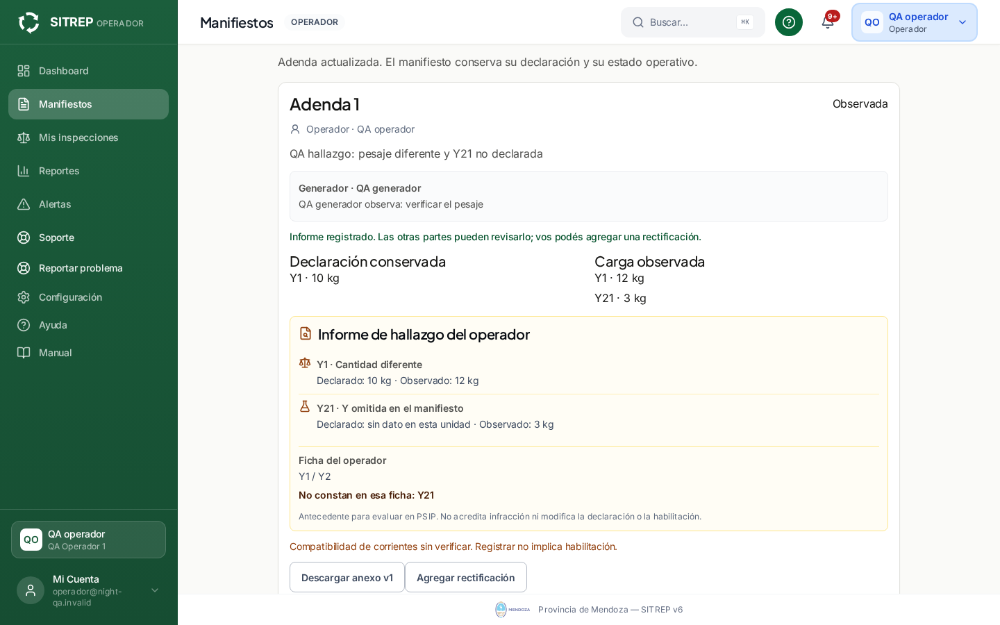
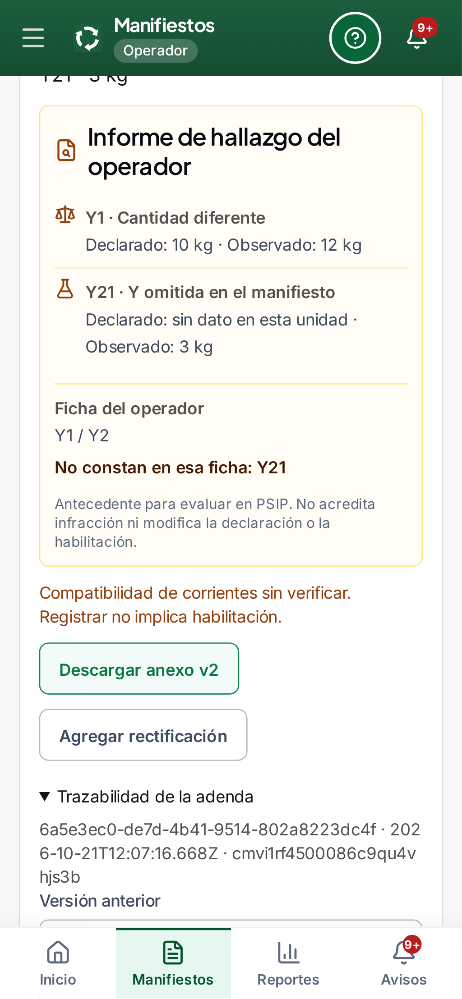
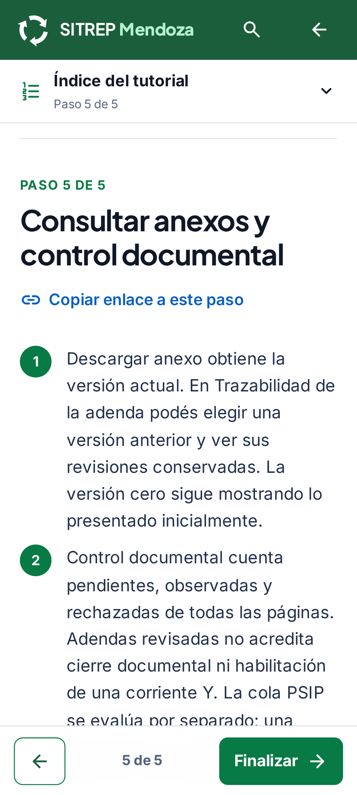

# Adendas operativas: hallazgos, decisiones y avisos — 21/10/2026

Revisión terminada sólo en preview, sobre `dcc61911` y los cambios del commit que acompaña este informe. Único checkout autorizado, rama `codex/sitrep-training-20261018`. **Sin inspeccionar ni modificar producción, sin main, push o workflows.** Última publicación documentada: `47ea8470`, con adendas/revisión posterior apagadas. Este trabajo no las habilita allí.

## Resultado y correcciones

- **Actualización entre sesiones:** la adenda abierta recibe las nuevas revisiones sin recarga manual; la campana invalida su consulta y lleva a **Abrir adenda y revisiones** en web/app.
- **Decisión concurrente:** el motivo queda asociado a la versión sobre la que comenzó a escribirse. Una respuesta nueva conserva ese texto y exige **Usar revisión actual** antes de enviarlo; el servidor mantiene el control de versión y la idempotencia.
- **Rectificación separada:** cerrar una rectificación y empezar otro hallazgo deja una adenda independiente, precargada con la declaración original. Ya no hereda el vínculo abandonado.
- **Autor y próxima acción:** se ve la cuenta de quien informó, la última decisión y su motivo. Los nombres/roles actuales son metadatos de presentación; no sustituyen las identidades históricas ni cambian el contenido firmado/conservado del anexo.
- **Avisos a partes activas:** se excluyen actores/cuentas inactivos y al autor; las identidades del aviso siguen siendo estables por versión/destinatario. El mensaje identifica al actor que actuó y no presenta su aprobación como unanimidad.
- **Nueva corriente Y a autoridad:** el aviso conserva manifiesto, adenda, versión, responsable de la decisión, corrientes y referencia de revisión. La falta de autoridad activa designada devuelve **409 con indicación para Administración**, en vez de un 500 genérico. Decisión, versión y avisos se revierten juntos; el motivo escrito permanece en pantalla.

No se ampliaron permisos de creación/revisión, no se cambió la regla de decisión, no hay migraciones ni dependencias nuevas. La autoridad artificial se designó sólo en el entorno de prueba; el ADMIN común siguió sin poder resolver por defecto.

## Circuito comprobado

1. Operador en destino registra carga observada completa: Y1 de 10 a 12 kg y Y21 omitida de 3 kg, con motivo.
2. Se conserva la declaración original y se genera el informe del operador, con diferencias y ficha de corrientes. Los antecedentes PSIP de generador/operador siguen siendo hechos por evaluar; no son infracciones automáticas.
3. Generador observa desde su cuenta. Transporte ve la respuesta, reconoce la versión nueva y registra su aprobación individual. La pantalla del operador se actualiza sin recargar.
4. Las partes reciben campana con destino correcto. La autoridad designada recibe la nueva Y y abre el mismo expediente desde web/app.
5. Se consultan anexos e historial. Una rectificación agrega otra adenda pendiente; no elimina el rechazo/observación anterior ni copia una aprobación.
6. Rechazo, ajenos, autoaprobación, ADMIN no designado, reenvíos y acciones simultáneas se comprueban también por HTTP real. El transporte puede informar diferencias sin atribuirse un hallazgo del operador en destino.

**Contrato conservado:** cada revisión es individual y la última determina el estado mostrado; las anteriores siguen en el historial. No se inventa unanimidad de adendas ni se la confunde con las tres aprobaciones del manifiesto. Revisar una adenda no cambia la etapa física, no habilita una corriente ni acredita cierre documental. La cola PSIP no se descarta al aprobar.

## Validación

| Control | Resultado |
| --- | --- |
| Backend dirigido: dominio, permisos, revisiones, avisos y PDF | **36/36** |
| Interfaz, navegación de avisos y manual | **57/57** |
| E2E final: recorrido y manual × escritorio/web móvil/app | **6/6**, sin reintentos, saltos ni casos inestables |
| HTTP real | **10 grupos** |
| Autoridad ausente: error recuperable y rollback atómico | **1 grupo**, repetido sobre el backend final |
| Flags apagados: consultas/escrituras cerradas | **1 grupo** |
| Tipos/backend y builds web/app | PASS |
| Lint de los dos archivos de producto frontend modificados | **0 errores, 0 advertencias** |
| Huellas de tablas previas del preview | **355 intactas** |
| Correo simulado, cuatro fases de adenda | **112 avisos renderizados y excluidos de entrega por ser artificiales; 0 en cola, 0 intentos, 0 envíos** |
| CAP | **Cuatro alias con 403**, sin abrir su base |

Pruebas en `76.13.234.213`, contenedor propio `sitrep-qa-training-20261018`, esquema nuevo `adenda_operations_20261021`. Serial/un worker, **1 CPU/2 GiB/swap cero**. Cuentas normales artificiales, sin impersonación de autenticación ni mocks de las transiciones HTTP. Una autoridad adicional artificial permitió ensayar su campana sin conceder ese rol al administrador genérico.

**Browser plugin not available** en esta sesión; se usó Playwright remoto. Vistas: escritorio 1440×900, recorrido web responsive 360×844 y app 390×844; manual responsive 360×800. Cuatro sesiones independientes en cada recorrido final. Verificados título/página visible, ausencia de overlay de error y CAP, cero errores de consola/ejecución, navegación, texto/acciones y ausencia de desbordamiento horizontal. Capturas revisadas visualmente. No equivale a certificar Android/iOS físicos, teclado, sensores o entrega externa.

La corrida `browser-fixed` ya pasó 6/6; la final repitió los seis y agregó la autoridad. **No se suman ambas como doce casos únicos.** Son suites dirigidas; no se repitieron suites unitarias globales del producto en esta tanda.

## Intentos y límites conservados

- Primer test de manual: esperaba el identificador de caché anterior. Se actualizó la expectativa exacta a `2026.21.2`; no se quitó el control.
- Primera integración: faltaba autoridad receptora con eventuales apagados. Se mantuvo el bloqueo, se mejoró el error y se probó su rollback. Se designó una cuenta artificial sólo en preview para completar el camino válido.
- Primer navegador: usaba número `10` donde Playwright exige el valor de input como cadena `'10'`. Fallo del harness corregido, mismas expectativas funcionales.
- Primera auditoría: esperaba elegibilidad de correo para manifiestos `isDemoData=true`. El bloqueo era correcto; se exige ahora exclusión explícita, manteniendo la simulación del contenido y cero entregas.
- Vite conserva advertencias de chunks grandes (incluido Vosk) y de directorio de salida externo al frontend. No hubo errores de build, OOM ni presión registrada (`memory.events`: max/oom/oom_kill = 0).

## Manual, fuentes y cierre

Manual **2026.21.2**: guía **Adendas: informar un hallazgo y revisar entre partes**, cinco pasos, en `tutorial.html?guide=adendas-hallazgos-partes`. Explica responsabilidades, versiones simultáneas, rectificación, anexos, autoridad y límites del cierre. **Renderer y CSS intactos.** El índice, enlaces, navegación móvil y recuperación del paso al recargar se comprobaron en las tres vistas.

Fuentes por hash: snapshot de 2.334 archivos; frontend/manual construido en `web-v2`/`app-v2`, backend recompilado tras completar el aviso a autoridad. Comprobados **936 archivos de frontend/manual y 405 de backend** contra las fuentes usadas; sin diff de Prisma, paquetes, workflows o renderer/CSS. Los cambios posteriores sólo cierran documentación/evidencia. Builds con `/api` de preview: **no desplegarlos**.

API/web, PostgreSQL y contenedor detenidos **21/10/2026 09:09:32 Mendoza**, sin cierre forzado del runtime ni OOM. Imagen, base artificial e historial/evidencias conservados. `main` permanece `c8402190edfc36b5e5d0dee1337c24bd1689420d`; cierre `[skip ci]`, sin push.

Antes de una futura habilitación productiva se necesita autorización, build para API final y SW propio, flags explícitos de adendas/revisión y una **autoridad operativa designada y activa** para recibir nuevas Y. No copiar la identidad QA ni habilitar proveedores/CAP. Este informe no autoriza publicar ni cambia la reversión vigente de `47ea8470`.

Evidencia compacta: [validación y hashes](validation-adendas-20261021.json). Evidencia completa local ignorada: `test-results-adendas-20261021/evidence/`; remota: `/opt/sitrep-qa-enterprise-20261016/source/.qa-adendas-20261021/`. 214 archivos recuperados y verificados por SHA-256, incluidos intentos fallidos. Las capturas siguientes proceden de la corrida final, con datos artificiales, sin edición:

