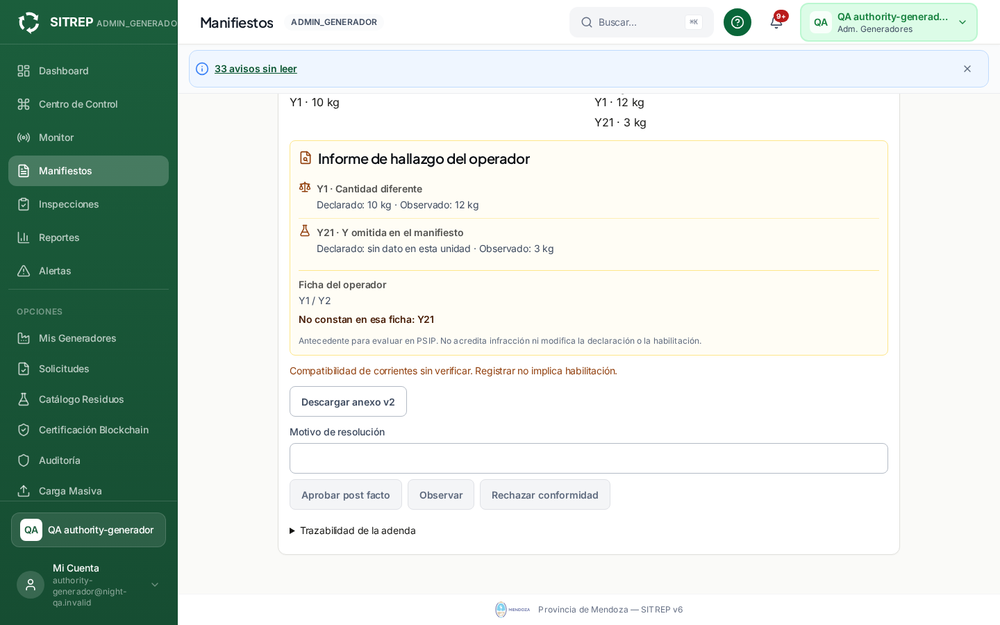
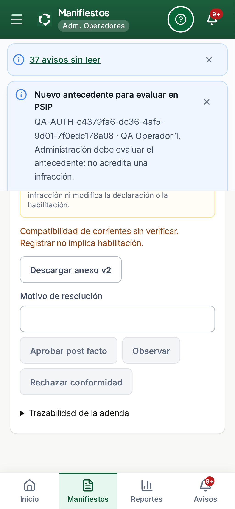

# Autoridades de adendas ordinarias — 21/10/2026

Trabajo sobre `ea8ae868`, que contiene el producto `db68b24e`, en el único checkout autorizado y rama `codex/sitrep-training-20261018`. **Sólo preview; sin inspeccionar ni modificar producción, cuentas reales o main.** Este candidato resuelve el impedimento técnico documentado en [la preparación anterior](PREPARACION-ADENDAS-20261021.md). El dueño confirmó después que por ahora importa incorporar las funciones que autorizan; difirió la asignación de cuentas concretas. El soporte quedó en **f7b0ad60**.

## Cambio y límites

- Pueden actuar como autoridad de adendas ordinarias las cuentas de **ADMIN, ADMIN_GENERADOR, ADMIN_OPERADOR y ADMIN_TRANSPORTISTA**, siempre activas y designadas explícitamente por ID en `MANIFEST_EXCEPTIONAL_REVIEWERS`. El rol solo no concede la revisión. No se designan todos los ADMIN automáticamente.
- Se conservan los bloqueos de autoaprobación, suplantación y sesión restringida. El servidor consulta la cuenta actual; desactivar la cuenta o cambiar su rol revoca el acceso incluso con un token previamente emitido.
- La aprobación de una corriente nueva avisa a las autoridades activas designadas de esos cuatro roles. Las cuentas inactivas, actores no administrativos y administradores no designados quedan excluidos. La ausencia de autoridad conserva el error recuperable **409** y revierte decisión, versión y avisos en la misma transacción.
- La interfaz identifica a los administradores sectoriales con nombres comprensibles en la autoría y última revisión. Conserva el diseño existente. Los nombres/roles mostrados son metadatos actuales; las identidades, motivos y fechas históricas no se reescriben.
- El cambio no amplía los permisos del circuito eventual, no habilita CAP, no altera la creación de adendas ni reemplaza las decisiones de las partes. No hay migraciones, dependencias o workflows nuevos.

**Contrato conservado:** cada revisión es individual; la última determina el estado mostrado y todas permanecen en el historial. No se inventa unanimidad de adendas ni se la confunde con la aprobación tripartita del manifiesto. Revisar no cambia la etapa física, cantidades declaradas, habilitaciones, antecedentes PSIP ni cierre documental.

## Circuito comprobado

1. Operador informa en destino Y1 de 10 a 12 kg y Y21 omitida de 3 kg; declaración original conservada.
2. Generador registra su aprobación individual. Las cuatro autoridades designadas reciben el aviso de nueva corriente con manifiesto, adenda y versión.
3. Cada autoridad abre su aviso desde la campana, consulta el hallazgo, registra su propia observación y aparece como autora de la revisión.
4. El operador recibe el aviso, vuelve a la misma adenda y ve decisión, motivo y autoridad. No puede aprobar su propio hallazgo.
5. Se repite en web de escritorio, web móvil y app. Se conserva además el recorrido de contrapartes: cambios entre sesiones, protección del motivo ante una versión nueva, anexo PDF, rectificación vinculada y hallazgo independiente.

HTTP también comprueba aprobación, observación, rechazo, reenvíos idempotentes, concurrencia, cuentas ajenas/no designadas/inactivas y cambios de rol. Los destinatarios de dos aprobaciones son exactamente cuatro autoridades activas por versión, sin duplicados al reenviar.

## Validación y aislamiento

| Control | Resultado |
| --- | --- |
| Backend, suite completa final | **1451/1451** |
| Frontend, suite completa final | **1796/1796** |
| Backend dirigido: adendas, autoridad, eventuales, avisos y PDF | **49/49**, incluidos en la suite completa |
| Interfaz, avisos y manual, repetidos sobre el contenido final | **57/57**, incluidos en la suite completa |
| Navegador: cuatro autoridades + recorrido entre partes + manual × tres vistas | **18/18**, cero omitidos, reintentos o inestables |
| HTTP real: adendas + autoridades | **10 + 5 grupos** |
| Sin autoridad / flags apagados | **1 + 1 grupos**, PASS |
| Backend/tipos/build web/build app/lint dirigido | PASS |
| Tablas previas del preview | **415 intactas**, conteos y huellas iguales |
| Correo simulado | **146 avisos**, cuatro fases; **0 cola, 0 intentos, 0 envíos** |
| CAP / push | Cuatro alias CAP **403**; canales/proveedores apagados |

Ejecución en `76.13.234.213`, contenedor `sitrep-qa-training-20261018`, esquema nuevo `adenda_authorities_20261021`, datos exclusivamente artificiales y cuentas ordinarias de QA. **Una tarea a la vez, un worker, 1 CPU/2 GiB/swap cero.** Las suites completas no se suman a las dirigidas para inflar el número de casos.

**Browser plugin not available**; se usó Playwright remoto ya instalado. Escritorio 1440×900, web responsive 360×800 (recorrido entre partes 360×844) y app 390×844. Logins por formulario, API real, sin simular las transiciones. Título/página, ausencia de overlay/CAP, consola/ejecución sin errores, ausencia de desbordamiento horizontal, navegación y capturas comprobados. Los avisos largos conservan su panel desplazable; no tapan el área de trabajo. No es certificación de Android/iOS físicos ni entrega externa.

El primer intento de navegador falló porque el test buscaba el aviso en la página inicial, con una bandeja de 50 avisos que también incluía antecedentes PSIP. Se corrigió el test para recorrer la paginación real, conservando el destinatario, contenido y destino esperados. La corrida completa siguiente pasó **18/18**; no se cambió producto ni se borraron avisos para hacerla pasar. Se conservan ambos intentos. Vite mantiene advertencias conocidas de tamaño de chunks y directorio de salida externo.

## Manual, evidencia y cierre

Manual **2026.21.3**: guía `tutorial.html?guide=adendas-hallazgos-partes`, explicación de autoridad explícita, roles, decisiones individuales y permisos de consulta. Índice, enlaces, navegación móvil y recuperación del paso comprobados. **Renderer 2026.20.6 y CSS 2026.20.5 intactos.**

Fuentes cotejadas por SHA-256: **407 archivos backend, 794 frontend fuera del harness, 255 del manual y 247 del harness QA**. Backend/frontend coinciden con la compilación y manual con su copia servida final. Ocho scripts remotos históricos ajenos a esta selección y un archivo AppleDouble se conservaron, sin ejecutarlos ni contarlos como fuentes de este checkout. Se recuperaron y verificaron **223 archivos de evidencia**, más estado final del contenedor y huellas del harness. [Resumen, resultados y hashes](validation-autoridades-adendas-20261021.json). Evidencia completa ignorada: `test-results-adenda-authorities-20261021/evidence/`; remota: `/opt/sitrep-qa-enterprise-20261016/source/.qa-adenda-authorities-20261021/`.

Al cerrar se separó `adenda-authorities.playwright.config.ts` de la configuración original, para no exigir fixtures nuevos al recorrido anterior. El listado real de Playwright confirma **6 casos originales independientes** y **18 casos exactamente iguales a los ejecutados** en el conjunto de autoridades. No se omitieron casos de la corrida aprobada.

API/web y PostgreSQL cerrados antes de detener el contenedor el **21/10/2026 10:51:57 Mendoza**. `Running=false`, `Pid=0`, `OOMKilled=false`; `memory.events` max/oom/oom_kill=0. Código 143 del proceso `sleep` al recibir la parada normal de Docker, después de cerrar los servicios. Base, imagen y evidencia conservadas. `main` sigue `c8402190edfc36b5e5d0dee1337c24bd1689420d`; cierre `[skip ci]`, sin push ni workflows. Los cambios posteriores a las pruebas sólo completan documentación, evidencia y separación equivalente de la configuración QA.

Capturas originales de la corrida aprobada, con datos artificiales y sin edición:

## Decisión del dueño y futura activación

La última inspección productiva, anterior a este trabajo, verificó **47ea8470**, adendas/revisión apagadas y lista de autoridades vacía. Encontró **0 ADMIN_GENERADOR activos, 0 ADMIN_OPERADOR, 1 ADMIN_TRANSPORTISTA y 8 ADMIN**. El dueño indicó las cuatro funciones y, el 21/10/2026, respondió que por ahora sólo importa incorporar que ellas autorizan. La asignación por correo/ID queda diferida por su decisión; no queda una pregunta sin responder ni se necesita para cerrar esta revisión. No se crearon/activaron cuentas ni se cambiaron roles por inferencia; la consulta de identidades de aquella preparación no examinó datos de negocio.

El soporte de esas autoridades y sus pruebas están completos; no se requiere ahora identificar personas ni cambiar el mecanismo de designación explícita. La aclaración no autoriza una nueva publicación o activación. Cuando se retome esa etapa: resolver las identidades y cualquier alta/cambio de rol necesario por autorización expresa, aprobar el nuevo SHA, recompilar para `https://sitrep.ultimamilla.com.ar/api` y versiones SW de release, verificar configuración y respaldos, activar adendas/revisión y hacer smoke no mutante. **No desplegar estos bundles con `/api` de QA ni copiar usuarios artificiales.** CAP, correo y push deben permanecer cerrados; propuestas/relevos/GPS múltiple y uploads conservados.

Los paquetes previos de `db68b24e` no contienen este cambio. No se transfirieron artefactos ni se hicieron staging, migraciones o recargas productivas. La [reversión vigente de 47ea8470](DESPLIEGUE-PROPUESTAS-20261021.md) permanece intacta; no existe una nueva publicación que revertir.
