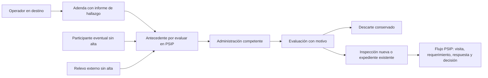

# Informe de hallazgo en la adenda y cola de revisión PSIP

## Definición del dueño

El 20/10/2026 el dueño confirmó que «IES» significa corrientes Y y precisó que el operador, al recibir o tratar lo que trae el transporte, informa lo que no coincide con la declaración del generador. **Ese informe de hallazgo forma parte de la adenda del manifiesto.** El informe alimenta la revisión para inspecciones; no es un acta de inspección ni una infracción determinada. También alimentan esa cola los participantes eventuales sin alta y los transportistas externos de un relevo.

**Candidato terminado y validado sólo en el preview aislado**, sobre la rama `codex/sitrep-training-20261018` y el único checkout del traspaso. No se publicó ni se inspeccionó producción; la última publicación sigue siendo `a6a5c005`. No autoriza activar eventuales/adendas en operación, reabrir CAP, enviar correo/push ni modificar `main`. No atribuye una regla normativa nueva ni presume mala fe, habilitación o compatibilidad por la aparición de una corriente.

## Recorrido

### Informe dentro de la adenda

- Un nuevo registro del operador vinculado en `ENTREGADO`, `RECIBIDO`, `EN_TRATAMIENTO`, `TRATADO` o `RECHAZADO` contiene automáticamente `informeHallazgo`. No depende de que el navegador se atribuya una autoría o envíe el resultado de la comparación. El servidor fija autor, fecha, etapa y evidencia.
- El formulario parte de la carga declarada. El operador ajusta cantidades, agrega las Y encontradas y explica el motivo. Sigue cargando la **carga observada completa**, sin sumarla a la original. Se conserva la revisión independiente de la contraparte y el control documental existente.
- Se comparan totales por la misma corriente y unidad. Cantidad distinta, Y omitida, corriente no observada y unidad diferente son resultados distintos. No se convierten unidades; la falta de observación no se guarda como una medición cero. El umbral numérico sólo evita residuos de coma flotante, no crea una tolerancia reglamentaria.
- La ficha `operador.corrientesY` se copia con su valor literal, fecha de actualización, referencia de habilitación/resolución y vencimiento disponibles. Una Y que no figura allí se marca **no consta en la ficha**, no «operador infractor». Si no hay datos reconocibles, **alcance sin verificar**. Figurar en la ficha tampoco certifica tratamiento compatible o habilitación vigente.
- El informe aparece dentro de la adenda y del anexo versionado. Las adendas anteriores conservan `informeHallazgo = NULL`: no se inventa un informe ni se modifica su contenido/huella documental histórica.
- Una observación de transporte o un registro antes de llegar conserva el comportamiento anterior; no se presenta como informe del operador en destino. La revisión o rectificación nunca borra el antecedente de origen.

### Qué entra a la cola

| Origen | Foco de evaluación | Evidencia conservada |
| --- | --- | --- |
| Informe de adenda con diferencia de cantidad, Y omitida, unidad diferente o corriente no observada | Generador del manifiesto | Declarado/observado, motivo, autor, fecha, etapa e informe |
| Informe con Y que no figura en la ficha del operador | Operador del manifiesto | Corrientes observadas y copia de la ficha usada al comparar |
| Informe sin datos verificables de alcance | Operador; primero verificar su ficha | La ausencia de fuente, sin afirmar falta de habilitación |
| Participante eventual sin vínculo de padrón | Cada lugar externo, por separado | Datos efectivamente declarados, rol, autor, etapa inicial y motivo |
| Relevo externo | Transportista eventual del tramo | Datos declarados por la transportista original, motivo, tramo, inicio y ubicación disponible |

La identidad incompleta se señala como condición recuperable del mismo antecedente, no como otra infracción. Un eventual recién declarado no acredita que ya trabajó: se conserva la etapa `REGISTRADO`. No se usan nombres/CUIT incompletos para fusionar personas ni se crea un actor genérico. Un relevo registrado no se etiqueta sin alta; no se copian enlaces, tokens o secretos GPS a la cola. No se incorporan otras infracciones o disparadores por conjetura.

Un informe sin diferencias y con las Y presentes en la ficha no crea un caso vacío. Si concurren diferencia del generador y falta de alcance del operador, existen dos focos por rol, unidos a **la misma adenda**. La clave única origen + referencia + rol evita duplicados de reintentos. La creación de la fuente y sus antecedentes es transaccional: si falla la evidencia/cola, tampoco se confirma un informe sin su antecedente.

## Evaluación y acceso

`Inspecciones → Cola de revisión` muestra filas compactas, búsqueda por manifiesto/actor, filtro de estado/rol y paginación aplicada por el servidor. Estados: **Por evaluar**, **En evaluación**, **Con inspección**, **Descartada con motivo**. Registrar la lectura no cambia el estado.

La administración general o sectorial competente evalúa desde su propia sesión, con motivo y control de versión. Puede tomar en evaluación, descartar conservando evidencia, vincular un expediente accesible del mismo actor o abrir una inspección. La apertura y el vínculo se confirman juntos; si otra persona ya evaluó/vinculó el antecedente, se revierte la apertura. Un reintento del mismo pedido recupera la misma inspección.

Un externo sin identidad sólo se vincula inicialmente a un expediente sin responsable, bajo jefatura general; abrirlo crea un hallazgo espontáneo. La identificación posterior usa el mecanismo existente de PSIP durante la etapa editable, conservando la declaración externa original. No se concede acceso a una persona sin cuenta o vínculo.

El inspector ve los antecedentes de sus inspecciones asignadas y no evalúa la cola de administración. Los administradores sectoriales ven sólo su tipo de actor. Un vínculo no concede acceso al expediente si sus permisos no lo permiten. Las partes ordinarias ven su informe en la adenda y las comunicaciones formales en Mis inspecciones; no ven la cola interna. El evento de vínculo del expediente es interno, con origen y huella; no se expone al inspeccionado como actuación pública.

Hay campana interna para la administración competente al recibir un antecedente, sin copia al autor ni cuentas inactivas. No existe despacho de correo/push en este circuito. Las revisiones de partes, avisos post facto y comunicaciones formales PSIP conservan sus destinatarios y decisiones propios. Descartar un antecedente no aprueba una adenda ni libera un certificado.

## Persistencia y publicación futura

Migración aditiva `20261020210000_inspection_intake`: columna JSON nullable en adendas y tabla `antecedentes_fiscalizacion` con evidencia inmutable, huella canónica SHA-256, origen único, versión, historial agregado y vínculo opcional a inspección. No actualiza fuentes históricas ni rellena una cola retrospectiva. No altera fórmula TEF, alta, corrientes de padrón, firmas, cantidades, reglas de revisión/certificación o facultades de inspección.

Una publicación requerirá autorización específica, respaldo verificado, migración, versión de caché/SW y compilaciones con API final. Las funcionalidades de origen conservan sus flags existentes. Las pruebas de origen habilitan adendas/eventuales sólo en procesos y builds del esquema artificial privado; eso no activa la instalación productiva. El manual **2026.20.17** conserva su CSS/renderer por hash y agrega la guía **Informe de hallazgo: de la adenda a PSIP**, con dos capturas originales de QA.

Tras una eventual publicación, una contención debe conservar base, evidencias y backend compatible con reservas ATM, tramos e informes/cola; puede retroceder la interfaz de forma controlada. No borrar columnas/antecedentes, restaurar una base anterior ni volver a un backend que deje de registrar las fuentes. Aquí no se ejecutó ningún rollback o despliegue productivo.

## Validación

Validación terminada en `76.13.234.213`, contenedor propio `sitrep-qa-training-20261018`, un proceso por vez, un worker, **1 CPU, 2 GiB y swap cero**. Sólo esquema nuevo **`inspection_intake_20261020`** de la base artificial; no se migraron los esquemas compartidos/anteriores ni CAP.

| Comprobación | Resultado |
| --- | --- |
| Backend dirigido: dominio, adendas, documentos, eventuales, acceso/relevos y flujo de inspecciones | **69/69** |
| Frontend dirigido: informe, cola, filtros, fallos de red, versión concurrente y expediente existente | **43/43** |
| API real: origen, permisos, destinatarios, concurrencia, apertura y conservación | **11 grupos** |
| Casos adicionales de alcance, rectificación y varios antecedentes en una inspección | **4 grupos** |
| Fallo forzado de la cola, rollback del informe/avisos y reintento del mismo pedido | **3 grupos** |
| PDF real actual/histórico, evidencia del informe y huella estable, sin caché compartida | **3 grupos**, extracción nativa y revisión visual |
| Configuración efectiva con flags originales apagados y CAP cerrado | **3 grupos**, sin nuevos antecedentes por rutas cerradas |
| Navegador real con backend: web escritorio, web móvil y app | **9/9**, cero omitidas, inestables o reintentos |
| Manual: contenido, enlaces, copia íntegra, capturas y regresión de pagos/altas | **24/24** |
| Manual final en navegador, con las dos capturas cargadas y links Web/App | **3/3** |
| TypeScript, ambos builds, lint crítico, diff Prisma del esquema | **PASS**, diff vacío |
| Migración SQL exacta, ensayo con rollback y preservación de adenda histórica | **4 grupos** |
| Auditoría de fuentes, acceso, hashes y proveedores | **4 grupos**, más **26 archivos de producto/manual** contrastados con la prueba de fuentes local/remota |

Migración SHA-256 **`83adb4d86cb0d4c1260335957dfdbed111f40ed61f258e94e2cd7be767d8d994`**. La adenda artificial histórica conserva todos sus valores previos y recibe sólo `informeHallazgo = NULL`. Las **115 tablas** de los esquemas `public` y `payment_identity_20261020` conservaron sus cantidades y huellas completas. No hubo resets ni limpieza de ejercicios interrumpidos. La cola final conserva **49 antecedentes artificiales**, sus fuentes y claves únicas por origen/rol; sus huellas canónicas coinciden después de persistir como JSONB. Cero correos encolados; SMTP/VAPID vacíos y push apagado.

Los casos prueban que una Y omitida pero presente en la ficha del operador genera sólo el foco del generador; una Y original que no consta en la ficha genera el foco del operador aunque coincidan las cantidades. Ficha ausente o no interpretable produce alcance sin verificar. Cambiar la ficha después no cambia el informe guardado. El rechazo/observación/aprobación de la adenda no borra ni resuelve la cola. También se probó que una rectificación conserva el informe anterior y que un segundo antecedente puede vincularse al mismo expediente sin abrir otro.

Navegador: creación del informe por operador, consulta y observación de contraparte, cola administrativa, apertura asignada y enlace de seguimiento; relevo externo y tres lugares eventuales incompletos independientes; guía pública sin llamadas de negocio. Los mapas y fuentes siguen el aislamiento existente: tipografías originales desde caché verificada y tiles etiquetados de QA. Se verificaron geometría, controles y ausencia de desborde, y se revisaron capturas de escritorio/app y el anexo. No es suite global, certificación Android física, sensor/GPS de fondo, carga masiva ni notificación fehaciente.

Se conservan los intentos fallidos y sus correcciones. El primer paquete omitía el SQL porque el directorio de migraciones está ignorado: se incorporó explícitamente antes de aplicar. El primer fixture intentó usar `categoria` en transportista; se corrigió sólo la preparación y se conservaron las filas ya creadas. Una unitaria nueva esperaba la fila antes de terminar su refetch; ahora espera su presencia sin cambiar expectativas. En navegador se corrigió un selector de combo y otro que elegía el índice de escritorio oculto en móvil; no se alteró el producto para pasarlos. La prueba estática del manual exigía «no acredita infracción» y la frase decía «ni acredita infracción»: se hizo explícita la redacción, manteniendo la exigencia. Los recorridos posteriores usan casos nuevos y artefactos separados; no se borraron antecedentes para repetir.

Evidencia privada: `test-results-inspection-intake-20261020/` local y `.qa-inspection-intake-20261020/` remoto, con informes, logs/trazas de intentos, documentos, fuentes y `acceptance.json`. Las capturas incorporadas al manual tienen huellas/dimensiones en `manual/inspection-intake-capture-provenance.json`. Los bundles QA usan `/api` local y flags de origen habilitados sólo para el ensayo: **no son paquetes para desplegar directamente**.

**Cierre: 20/10/2026, 17:57:18 Mendoza**. API, servidor estático y PostgreSQL propios cerrados; contenedor detenido `Running=false/Pid=0`, salida 143 esperada por SIGTERM, `OOMKilled=false`. `memory.events max/oom/oom_kill = 0/0/0`. Imagen, base artificial y evidencia conservadas. CAP y proveedores permanecen cerrados; flags productivos/configuración no consultados ni modificados. `main` conserva **`c8402190edfc36b5e5d0dee1337c24bd1689420d`**, sin push ni workflows. Commits de cierre con `[skip ci]`.
