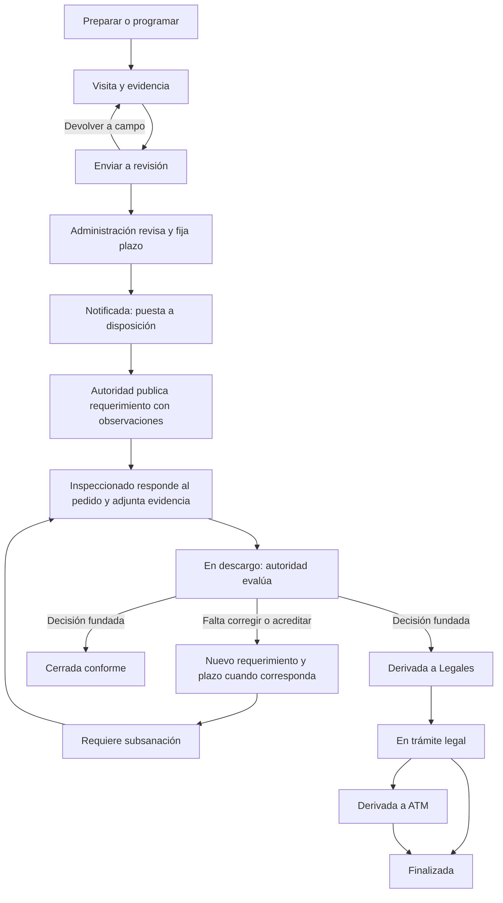

# PSIP — flujo de inspecciones

Revisión del 20/10/2026. PSIP es el nombre de este recorrido de producto y manual; no crea un procedimiento normativo ni amplía facultades. Alcance: interfaz, navegación, seguimiento de observaciones y documentación. **Sin publicación en producción ni cambios en `main`.**

## Hallazgo principal

El seguimiento solicitado **ya existe** en el modelo y las API: requerimiento de la autoridad con plazo, respuesta/descargo/subsanación del actor, nueva evaluación y cierre conforme o derivación. No es otro tipo de inspección. Generador, transportista, operador, petróleo, aire o espontánea describen la clasificación/origen; seguimiento describe la etapa del mismo expediente.

La interfaz mezclaba trece estados en un selector plano y destacaba sólo campo/revisión. No aclaraba quién debía actuar, ni distinguía un expediente puesto a disposición sin requerimiento escrito de uno con observaciones pendientes. Un plazo antiguo también podía mostrarse como vencido después del cierre. El cierre formal borra el plazo activo; el resumen ahora recupera el último plazo histórico de los requerimientos conservados, sin reabrirlo. El listado no inventa una fecha activa cuando el servidor ya la retiró. La captura aportada se usó únicamente como referencia visual: no se abrieron sus expedientes ni se utilizaron sus actores para pruebas o manual.

## Etapas de navegación

| Etapa PSIP | Estados conservados | Responsable / resultado |
|---|---|---|
| Preparación y visita | BORRADOR, PLANIFICADA, EN_CAMPO, EN_REVISION | Inspector asignado documenta; administración competente revisa. Planificada es la visita programada, no un plazo de subsanación. |
| Seguimiento | NOTIFICADA, EN_DESCARGO, REQUIERE_SUBSANACION | Autoridad publica observaciones; inspeccionado presenta respuesta; autoridad evalúa. |
| Derivaciones | DERIVADA_LEGALES, EN_TRAMITE_LEGAL, DERIVADA_ATM | Seguimiento administrativo de la derivación, fuera del intercambio abierto. |
| Cerradas | CERRADA_CONFORME, FINALIZADA, CANCELADA | Resultado y archivo consultable; sin nueva presentación en el intercambio. |

**Cerrada conforme es el resultado favorable del seguimiento**, ubicado en Cerradas para no contarlo como trabajo por responder. No se fusionaron estados ni se modificaron sus transiciones. ATM conserva el nombre existente; no se inventa una nueva competencia “TM”. La agenda sigue siendo la organización de visitas, separada del plazo del requerimiento.

Los grupos filtran en base de datos **antes de paginar**, bajo los mismos permisos de sector, búsqueda, tipo y actor. Los contadores mantienen el ámbito global de esos filtros, sin limitarse a las 25 filas visibles. Exportación y copias offline aplican el mismo conjunto de estados. Se conservan los enlaces por estado y se agrega `etapa` al enlace de navegación.

## Circuito y puntos de control

El diagrama muestra el recorrido operativo normal; no reemplaza la matriz de transiciones del servidor. La cancelación y las transiciones administrativas existentes conservan sus restricciones. El cierre conforme o la derivación de intercambio requieren fundamento; no corresponden al actor inspeccionado ni al inspector por el solo hecho de estar asignado.

1. El inspector documenta acta, controles, contraste, evidencias e informe, guarda y envía a revisión. Se conserva el snapshot del cierre de campo. **Terminó campo, no necesariamente el expediente.**
2. Administración competente revisa completitud, responsable y plazo antes de aprobar. `NOTIFICADA` pone a disposición el expediente, pero **no crea el texto de un requerimiento ni envía una comunicación externa**.
3. En **Expediente → Comunicaciones → Nuevo requerimiento**, la autoridad registra qué observó, qué requiere y el plazo que corresponda. La fecha/hora se fija expresamente; PSIP no determina X días, su base legal ni su cómputo.
4. La entidad destinataria abre **Mis inspecciones** con su cuenta en web/app. Elige el pedido, presenta respuesta, descargo o acreditación de subsanación y adjunta evidencia. La respuesta se vincula a la actuación concreta. Abrir no cuenta como responder.
5. La autoridad evalúa lo presentado. Un requerimiento estando `EN_DESCARGO` pasa a `REQUIERE_SUBSANACION`; la siguiente presentación del actor pasa a `EN_DESCARGO`. Se conserva cada ida y vuelta, no se sobrescribe el acta.
6. Administración competente registra la decisión fundada de cierre conforme o derivación a Legales. El intercambio queda cerrado y consultable. Las etapas legales y ATM no acreditan por sí mismas envío, recepción, sanción o firmeza.

Se admiten presentaciones tardías, marcadas como fuera de plazo. Ni la tardanza ni el vencimiento producen rechazo, sanción o derivación automática. Una respuesta vinculada resuelve la ausencia de respuesta a ese pedido, no implica aceptación de la subsanación ni contesta otros requerimientos.

## Contenido de las comunicaciones

Ejemplos artificiales de redacción, para completar con los hechos del expediente; no son textos normativos ni mensajes enviados:

- **Requerimiento de la autoridad:** «En la inspección [número] se observó [hecho]. Presentá o corregí [pedido concreto] y acompañá [evidencia] hasta [fecha y hora fijadas por la autoridad]. Respondé esta actuación desde Mis inspecciones».
- **Presentación del inspeccionado:** «En respuesta a la actuación [número], informo [explicación/corrección] y adjunto [evidencia]». El sistema confirma registro, sin anunciar aprobación.
- **Nueva subsanación:** «Respecto de tu presentación [número], falta [elemento concreto]. Se requiere [acción y evidencia], con el plazo registrado». Se agrega como actuación nueva vinculada, no se edita el requerimiento anterior.
- **Decisión:** identifica qué se evaluó y por qué se cierra conforme o deriva. El registro no afirma correo recibido, sanción ni firmeza.

## Qué indica la pantalla

| Situación | Autoridad | Inspeccionado |
|---|---|---|
| Notificada sin requerimientos | Falta publicar el requerimiento | La autoridad debe publicar las observaciones |
| Uno o más pedidos sin respuesta vinculada | A la espera del inspeccionado; cantidad de pedidos pendientes | Tenés requerimientos por responder; acceso directo al más reciente y acción por pedido en el registro |
| Todos los pedidos tienen presentación vinculada | Revisar las presentaciones recibidas | Tu presentación está registrada; pendiente de evaluación |
| Cerrada o derivada | Intercambio concluido y actuaciones disponibles | Consulta del historial; sin acciones de respuesta; último plazo histórico |

La indicación se calcula con las actuaciones reales, no sólo con el nombre del estado o la última actividad general. La consulta del intercambio conserva la primera apertura del destinatario; ese GET existente registra lectura. Las pruebas de esta revisión se ejecutan exclusivamente sobre datos artificiales del preview.

## Resiliencia del intercambio

La prueba de subsanación repetida descubrió una carrera real: un guardado offline en curso podía recrear un borrador ya enviado después de su limpieza. Al recargar, ese borrador abría el formulario anterior y ocultaba el acceso directo al pedido nuevo. Se serializan los guardados, se bloquean los temporizadores durante el envío y se espera a que terminen las escrituras antes de quitar la copia enviada. Una lectura local tardía tampoco reemplaza una acción o envío más reciente. Si el servidor rechaza la presentación, se conserva el formulario y se reanuda el guardado de texto y adjuntos; nunca se autoenvía.

## Comunicación: implementado y límites

- El portal registra presentación, autor, destinatario, fecha, versión, primera apertura, respuesta relacionada, adjuntos y huellas encadenadas. Los permisos existentes limitan la participación a la entidad vinculada; no se muestran los borradores internos ni expedientes ajenos.
- **Extensión posterior: el intercambio genera campanita por cada requerimiento, respuesta y decisión**, con destinatarios limitados a su contraparte y sin correo/push. Ver [avisos internos PSIP, alcance y validación](PSIP-AVISOS-INTERNOS-20261020.md). Las reglas de vencimientos y falta de respuesta siguen siendo otro circuito; no se activan en esta revisión. Un evento de expediente no es una prueba de aviso externo entregado.
- Correos y push permanecen apagados; CAP permanece cerrado. La puesta a disposición y la primera apertura no acreditan por sí solas una notificación fehaciente. Se preserva la distinción ya documentada en [marco legal y resiliencia](INSPECCIONES-MARCO-LEGAL-Y-RESILIENCIA.md).
- Una espontánea sin responsable identificado puede documentarse y revisarse, pero el servidor impide notificar sin responsable vinculado. El vínculo se completa en Borrador, Planificada o En campo; si ya está En revisión, la administración debe devolverla a campo antes de asociar el responsable. Una persona externa sin cuenta/vínculo no obtiene acceso al portal por completar un contacto libre. No se habilitaron accesos, se crearon usuarios reales ni se enviaron comunicaciones.

Pendientes institucionales fuera de esta mejora: canal formal y constancia de notificación, cómputo aplicable del plazo, participación de un inspeccionado externo sin alta y protocolo de derivación/recepción a Legales o ATM. Los avisos automáticos se incorporan en la extensión enlazada; no convierten la campana en un canal externo ni fehaciente.

## Manual y validación

Guía **PSIP: del control al seguimiento de la inspección**, disponible desde la portada, perfiles de inspector/administración/actores y directorio §18. Las guías previas permanecen y se conserva el diseño del manual. La agrupación se validó con `help-data.js` **2026.20.12**; la extensión de avisos lo actualiza a **2026.20.13**.

La futura publicación debe incluir **backend + web + app + manual del mismo candidato**: el backend agrega el filtro opcional `estados`, por lo que publicar sólo la interfaz sobre un backend anterior no aplicaría correctamente los grupos. No hay migraciones ni flags nuevos. Esta revisión no publica artefactos, no reinicia servicios productivos y no cambia la configuración de comunicaciones o CAP.

Validación terminada en el preview aislado `76.13.234.213`, contenedor propio, un worker, **1 CPU, 2 GiB y swap cero**, pruebas pesadas sólo allí:

| Comprobación | Resultado |
|---|---|
| Backend dirigido: filtros, permisos, estados, intercambio e integridad/concurrencia | **54/54**, 6 archivos |
| Frontend dirigido: navegación, seguimiento, borrador offline, historial y permisos | **80/80**, 9 archivos |
| Recorridos únicos de navegador | **18/18**: 6 escritorio, 6 web móvil y 6 `/app` |
| Contenido, enlaces, integridad y copia del manual | **20/20** |
| Navegación manual nueva y anterior, en las tres vistas | **6/6**, sin llamadas API del recorrido de ayuda |
| Captura enfocada de la acción en app | **1/1**, desplazamiento normal, sin alterar la imagen ni reabrir casos cerrados |
| TypeScript backend/frontend, builds web y app, lint crítico | **PASS**, sin warnings de lint |

El recorrido de navegador incluye visita y checklist completos con inspector, revisión de jefatura, requerimiento, descargo, segunda subsanación, cierre conforme y derivación a Legales. La repetición del seguimiento se ejecutó con generador, transportista y operador. Se comprobó la prohibición de abrir intercambios ajenos y de notificar una espontánea sin responsable, el filtro antes de paginar, sus enlaces al recargar, estados cerrados y plazo histórico después de que el servidor quite el activo. Las comprobaciones de lectura y ancho incluyen 320 px; las vistas principales son 1440×900 y 360×800.

Aceptación **incremental**, tomando la última prueba aprobada por escenario y proyecto sobre los mismos ocho archivos de producto verificados contra el build. No se ocultan los intentos fallidos ni se suman duplicados como casos nuevos. Evidencia privada local `test-results-psip-20261020/flow-acceptance.json` y reportes originales; equivalente remoto `.qa-psip-20261020/`. Los errores HTTP 400/403 de los casos negativos son esperados; no hubo errores JavaScript no controlados en los recorridos aceptados.

Se usó Playwright remoto: Browser plugin no disponible. Fuentes públicas originales servidas desde caché verificada y mapas etiquetados como simulados; no se certifica cartografía externa, teléfonos Android físicos, sensores, segundo plano, entrega de correo/push ni cumplimiento normativo global. No se repitieron las suites completas del repositorio. Los bundles QA usan `/api` de loopback: **no son un paquete para desplegar directamente**.

Se verificó la configuración real de los procesos QA: CAP cerrado (`2000-01-01T00:00:00Z`), flags originales false, SMTP/VAPID vacíos y correos/push apagados. El límite de memoria se mantuvo; `memory.events` registró `max=2102`, `oom=0`, `oom_kill=0`. Los artefactos y la imagen se conservan.

Capturas originales, sólo datos artificiales, con hashes y dimensiones en `manual/psip-capture-provenance.json`:

- [Etapas y filtros en escritorio](manual/screenshots/desktop/psip-etapas-20261020.png).
- [Plazo y respuesta en app, vista desplazada al botón](manual/screenshots/mobile/psip-responder-20261020.png).
- [Cierre y registro conservado](manual/screenshots/desktop/psip-cierre-20261020.png).

Se conservan los intentos previos en la evidencia privada. La primera tanda unitaria detectó un comparador de test inadecuado, corregido para exigir el valor exacto. El primer recorrido nuevo quedó esperando un selector de etiqueta del combo; la traza permitió cambiarlo por su rol accesible sin cambiar el producto. En la repetición, generador completó el circuito y transporte completó el cierre, pero la expectativa de fecha en el listado era incorrecta: el cierre real limpia el plazo activo. Se fortaleció la comprobación sobre el expediente propio y se corrigió el resumen del historial para recuperar la fecha desde el requerimiento conservado. Se usa una nueva tanda de casos artificiales, sin restablecer ni borrar los anteriores.

La validación del manual detectó una referencia histórica a `guides[0]`: agregar PSIP primero desplazaba la guía de capacitación y sus enlaces. Se sustituyó por búsqueda del identificador `capacitacion-por-rol`; se conservaron las expectativas anteriores sobre los cinco equipos y sus 76 recursos. Los 20 controles de contenido y los seis recorridos de navegador pasaron después de la corrección.

Preview detenido el **20/10/2026 a las 09:52:26 Mendoza**: API, servidor QA y PostgreSQL cerrados antes de detener `sitrep-qa-training-20261018`; salida SIGTERM (143), `OOMKilled=false`. Imagen y evidencia conservadas. Relevos y GPS múltiple permanecieron true en ambos procesos QA; no se cambiaron flags productivos. Cierre local `[skip ci]`, sin push/workflows ni cambios a `main`.

La configuración dedicada `psip-capture.playwright.config.ts` es una captura de auditoría de esta revisión: usa el requerimiento artificial aún pendiente preservado en `third-browser-fixture.json`, no un expediente cerrado vuelto atrás. Ese insumo queda en la evidencia privada remota y no es necesario para la suite normal PSIP.
